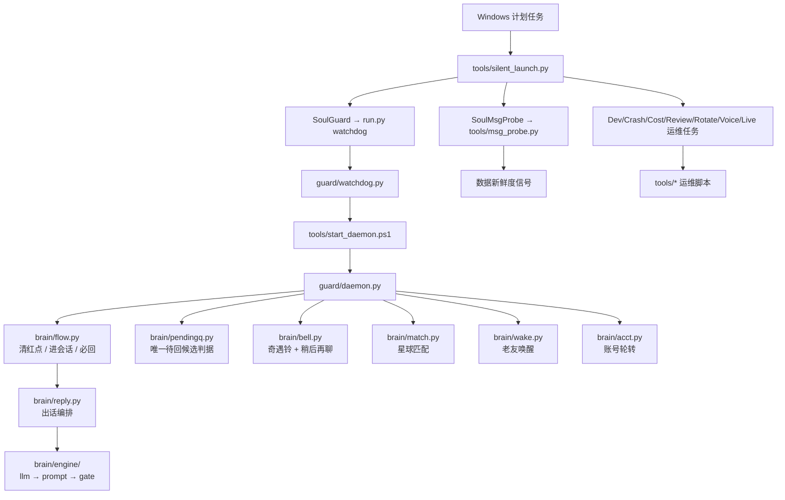
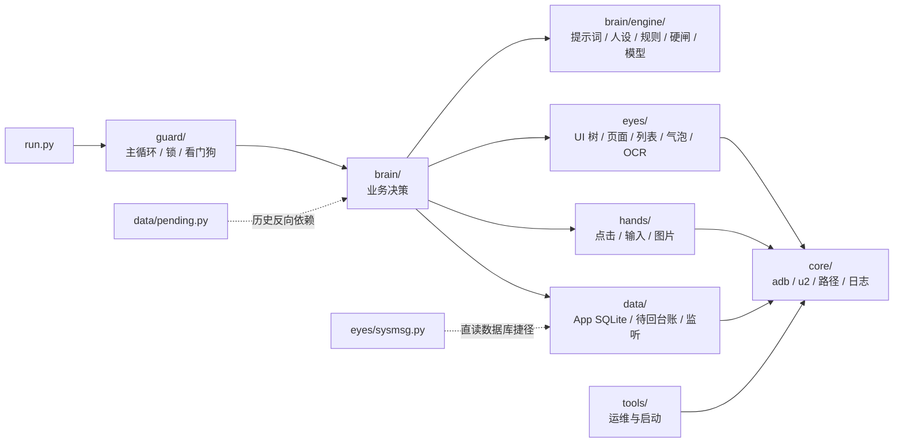

# Soul 1.0 生产架构图

> 2026-11-14 副机 `E:\soul1.0` 实测整理。
> 基线 HEAD：`d18be4e`（`chore(launch): daemon 静默启动 + 日志轮转收紧`）。  
> 本文只描述当前生产结构；历史版本文件已移入可恢复回收区，不再属于运行面。

## 1. 进程与任务拓扑



Soul 相关计划任务共 9 个：`SoulGuard`、`SoulMsgProbe`、`SoulLiveWatch`、`SoulDevWatch`、`SoulCrashAlert`、`SoulCostWatch`、`SoulDailyReview`、`SoulLogRotate`、`SoulVoiceCheck`。另有 `MuMuLaunch`、`MuMuLaunch0` 两个模拟器启动任务，当前总计 11 个。

所有 Soul 运维入口统一经过 `tools/silent_launch.py`。该启动器必须保留，同目录下 `tools/_silent/sitecustomize.py` 也不能删除；它们负责 `pythonw.exe` 静默启动和子进程无窗口化。

## 2. 包依赖与职责



正常目标依赖方向是 `入口/守护 → brain → eyes/hands/data → core`。当前有三处需要后续架构治理的耦合：

1. `data/pending.py` 反向导入 `brain.pendingq`、`brain.sendgate`、`brain.verdict`，形成 `brain ↔ data` 环；运行稳定，本轮不贸然重构。
2. `eyes/sysmsg.py` 直接依赖 `data.imdb`，破坏“感知层只依赖 core”的理想边界。
3. `run.py match` 通过 `tests/t_match_loop.py` 实现独立匹配命令，因此该测试文件属于运行入口依赖，不能当普通测试清理。

## 3. 主业务链路

```text
消息/红点/奇遇铃
  → 读 App SQLite + UI 树判定会话
  → pendingq.candidates() / clear.sweep() 决定谁该处理
  → flow 进入唯一会话
  → reply + engine(persona/rules/brief/prompt/gate/llm) 生成
  → hands.input 发送并三态确认
  → pending/sendgate/reply_state 记账
```

主循环顺序是产品决策，必须保持：

```text
奇遇铃 → 红点/新消息 → 已读未回 → 唤醒 → 匹配 → 账号轮转 → 空闲扫铃
```

## 4. 当前代码规模

| 目录 | Python 文件 | 当前职责 |
|---|---:|---|
| `core/` | 4 | 设备、路径、日志 |
| `eyes/` | 9 | UI 树、页面、列表、气泡、主页、弹窗、OCR、系统消息、公开导出 |
| `hands/` | 4 | 点击、输入、图片、公开导出 |
| `brain/` | 34 | 决策、流程、出话引擎、案情包、账号与技能 |
| `data/` | 5 | App SQLite、待回台账、回复状态、变更监听、公开导出 |
| `guard/` | 4 | 主循环、单实例锁、看门狗、公开导出 |
| `tests/` | 20 | 保留的验收/回放测试 |
| `tools/` | 13 | 静默启动、探针、守护、运维与注册脚本 |

合计约 94 个 Python 文件、2.33 万行、1.18 MB（不含回收区）。

## 5. 当前保留的测试

`tests/` 仅保留可复用验收和入口依赖：

```text
_nolog.py                 t_casepack.py         t_match_loop.py
t_act_warn_level.py       t_chatlist.py         t_nav_ladder.py
t_bell_logic.py           t_dbcheck.py          t_outtalk_contract.py
t_device.py               t_eyes.py             t_preflight.py
t_flow_dry.py             t_flow_fail_level.py  t_prompt_dump.py
t_followup_replay.py      t_kw_masked_phone.py  t_run_loop.py
t_skills_replay.py        t_wake_plan.py
```

历史 `t_probe_*`、`t_switch*`、`t_doubletap_*`、相册/截图/一次性诊断脚本已移入 `E:\_soul_trash_20261114`，可按 `manifest.csv` 和 `rollback.ps1` 恢复。

## 6. 当前运维入口

| 文件 | 作用 |
|---|---|
| `tools/silent_launch.py` | 所有计划任务的统一静默启动器 |
| `tools/_silent/sitecustomize.py` | 子进程无窗口注入 |
| `tools/_silent/win_audit.py` | 静默启动辅助审计 |
| `tools/watchdog_live.py` | 进程/MuMu 存活兜底 |
| `tools/msg_probe.py` | 每 15 秒探测消息新鲜度 |
| `tools/devwatch.py` | 设备离线恢复 |
| `tools/logrotate.py` | 日志轮转 |
| `tools/crash_alert.py` | Traceback 告警 |
| `tools/cost_watch.py` | 模型成本统计 |
| `tools/daily_review.py` | 每日复盘 |
| `tools/voice_check.py` | 语音链路自检 |
| `tools/action_audit.py` | 动作审计 |
| `scripts/repo_sync.ps1` | Git 漂移检查和脱敏扫描 |

## 7. 清理边界

以下文件/目录禁止按“孤儿脚本”清理：

- `run.py`
- `core/`、`eyes/`、`hands/`、`brain/`、`data/`、`guard/`
- `tools/silent_launch.py`、`tools/_silent/`
- 10 个已上线 Soul 运维脚本
- `tests/t_match_loop.py`（`run.py match` 的运行依赖）
- `config/model.env`、`data/state/`、`logs/`、`memory/`、`models/`
