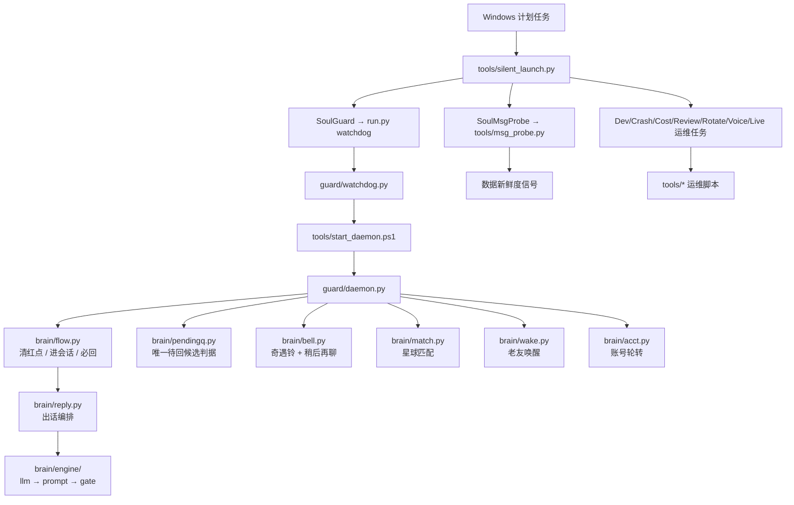
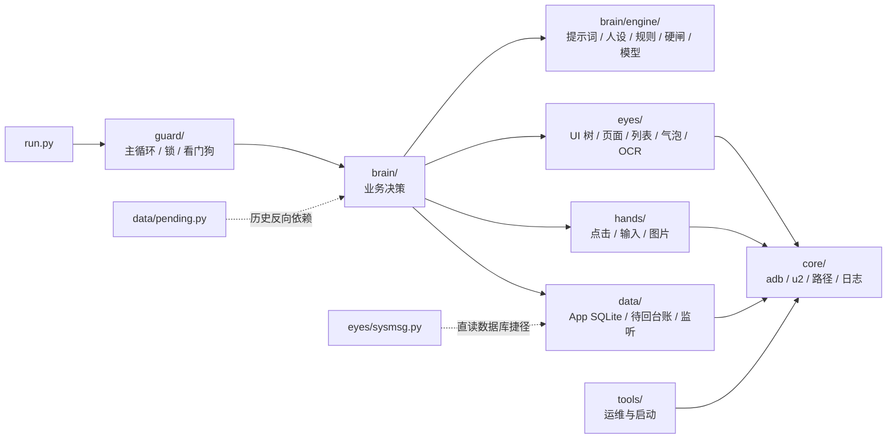

# Soul 1.0 生产架构图

> 2026-11-14 副机 `E:\soul1.0` 实测整理。
> 当前运行时 HEAD：`47d4440`（包含语音、锁、抢占和启动串行化）。
> 本文只描述当前生产结构；历史版本文件已移入可恢复回收区，不再属于运行面。

## 1. 进程与任务拓扑



Soul 相关计划任务共 9 个：`SoulGuard`、`SoulMsgProbe`、`SoulLiveWatch`、`SoulDevWatch`、`SoulCrashAlert`、`SoulCostWatch`、`SoulDailyReview`、`SoulLogRotate`、`SoulVoiceCheck`。另有 `MuMuLaunch`、`MuMuLaunch0` 两个模拟器启动任务，当前总计 11 个。

所有 Soul 运维入口统一经过 `tools/silent_launch.py`。该启动器必须保留，同目录下 `tools/_silent/sitecustomize.py` 也不能删除；它们负责 `pythonw.exe` 静默启动和子进程无窗口化。

`tools/start_daemon.ps1` 使用 `Global\Soul1DaemonStart` 命名互斥，把 SoulGuard、msg_probe 和人工启动的“检查后启动”串行化，避免两个启动器同时拉起 daemon。

## 2. 包依赖与职责



正常目标依赖方向是 `入口/守护 → brain → eyes/hands/data → core`。本轮已消除全部跨层违规：

1. `data/pending.py` 的冷却/已回判定改为读取 `data/pending_ledger.py`，不再反向导入 brain。
2. 系统消息判定抽到纯函数 `core/message_kind.py`；`eyes/sysmsg.py` 不再读 `data.imdb`。
3. `run.py match` 改走生产模块 `brain/match_runner.py`；`tests/t_match_loop.py` 只保留兼容包装。

静态依赖扫描当前仍有 4 个 brain 内部环：出话引擎内部、`clear/flow/pendingq`、`casepack/match/reply`、`nav/search`。它们不能再跨层扩散，但后续拆解需要单独回放窗口。

## 3. 主业务链路

```text
消息/红点/奇遇铃
  → 读 App SQLite + UI 树判定会话
  → pendingq.candidates() / clear.sweep() 决定谁该处理
  → flow 进入唯一会话
  → reply + engine(persona/rules/brief/prompt/gate/llm) 生成
  → hands.input 发送并三态确认
  → pending/sendgate/reply_state 记账
```

主循环顺序是产品决策，必须保持：

```text
奇遇铃 → 红点/新消息 → 已读未回 → 唤醒 → 匹配 → 账号轮转 → 空闲扫铃
```

### 安全点抢占

`pendingq` 在以下安全点检查 DB 变更信号：

- 每个候选开始前；
- 列表翻屏每一屏后；
- 搜索页等待和结果轮询期间；
- 当前候选人完成发送/放弃并回到安全页后。

抢占不会发生在“正在输入”或“发送结果尚未确认”的中间态，避免重复发送和串台。检测到新消息后立即结束本轮后续匹配/唤醒阶段，下一轮从红点/新消息开始。

## 4. 当前代码规模

| 目录 | Python 文件 | 当前职责 |
|---|---:|---|
| `core/` | 6 | 设备、路径、日志、结构化指标、纯消息分类 |
| `eyes/` | 9 | UI 树、页面、列表、气泡、主页、弹窗、OCR、系统消息、公开导出 |
| `hands/` | 4 | 点击、输入、图片、公开导出 |
| `brain/` | 36 | 决策、流程、候选排序、匹配运行器、出话引擎、案情包、账号与技能 |
| `data/` | 6 | App SQLite、待回台账、共享冷却/已回台账、回复状态、变更监听 |
| `guard/` | 4 | 主循环、单实例锁、看门狗、公开导出 |
| `tests/` | 27 | 保留的验收/回放与离线契约测试 |
| `tools/` | 13 | 静默启动、探针、守护、运维与注册脚本 |

合计约 106 个 Python 文件、24,004 行、1.21 MB（不含回收区）。

## 5. 当前保留的测试

`tests/` 仅保留可复用验收和入口依赖：

```text
_nolog.py                 t_casepack.py         t_match_loop.py
t_act_warn_level.py       t_chatlist.py         t_nav_ladder.py
t_bell_logic.py           t_dbcheck.py          t_outtalk_contract.py
t_device.py               t_eyes.py             t_preflight.py
t_flow_dry.py             t_flow_fail_level.py  t_prompt_dump.py
t_followup_replay.py      t_kw_masked_phone.py  t_run_loop.py
t_skills_replay.py        t_wake_plan.py
t_flow_preempt.py         t_health_contract.py
t_lock_health.py          t_metrics.py
t_pending_ledger.py       t_pending_policy.py       t_voice_contract.py
```

历史 `t_probe_*`、`t_switch*`、`t_doubletap_*`、相册/截图/一次性诊断脚本已移入 `E:\_soul_trash_20261114`，可按 `manifest.csv` 和 `rollback.ps1` 恢复。

## 6. 当前运维入口

| 文件 | 作用 |
|---|---|
| `tools/silent_launch.py` | 所有计划任务的统一静默启动器 |
| `tools/_silent/sitecustomize.py` | 子进程无窗口注入 |
| `tools/_silent/win_audit.py` | 静默启动辅助审计 |
| `tools/watchdog_live.py` | 进程/MuMu 存活兜底 |
| `tools/msg_probe.py` | 每 15 秒探测消息新鲜度 |
| `tools/devwatch.py` | 设备离线恢复 |
| `tools/logrotate.py` | 日志轮转 |
| `tools/crash_alert.py` | Traceback 告警 |
| `tools/cost_watch.py` | 模型成本统计 |
| `tools/daily_review.py` | 每日复盘 |
| `tools/voice_check.py` | 语音链路自检 |
| `tools/action_audit.py` | 动作审计 |
| `scripts/repo_sync.ps1` | Git 漂移检查和脱敏扫描 |

## 7. 生产观测

- `data/state/metrics.jsonl`：每轮一条结构化 `round_end`，待回阶段一条 `pending_end`，候选扫描变化时一条 `candidates`。
- `data/state/daemon.lock`：存活 daemon 由实际子进程持有；缺锁/被替换时 daemon 会自愈重建，若已有活 owner 则新进程退出。
- `tools/msg_probe.py`：缺锁时步骤龄为 unknown，不再把 Unix 纪元秒误报成“步骤未推进几十年”。
- `tools/watchdog_live.py`：日志静默和锁心跳联合判断，避免长阶段被单一日志来源误杀。
- `brain/voice.py`：先读 App 自带 `word`，为空时本地 Whisper 转写；会话摘要 `[语音]` 缺少 URL 时回查真实 type=5 `chatmsg` 行。
- 语音转写成功后会进入正常待回排序，并优先于较老的纯文本积压；搜索计划可用昵称、语音转写文本和历史唯一句。昵称缺失时会从 flow 日志回填，较老语音候选允许检查更深列表；已经开始的单条语音定位窗口不再被普通新消息无限打断。

## 8. 清理边界

以下文件/目录禁止按“孤儿脚本”清理：

- `run.py`
- `core/`、`eyes/`、`hands/`、`brain/`、`data/`、`guard/`
- `tools/silent_launch.py`、`tools/_silent/`
- 10 个已上线 Soul 运维脚本
- `tests/t_match_loop.py`（`run.py match` 的运行依赖）
- `config/model.env`、`data/state/`、`logs/`、`memory/`、`models/`
